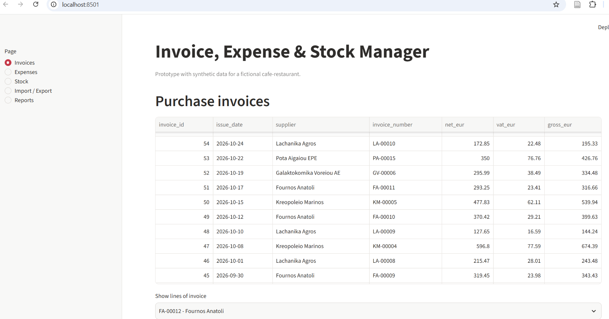
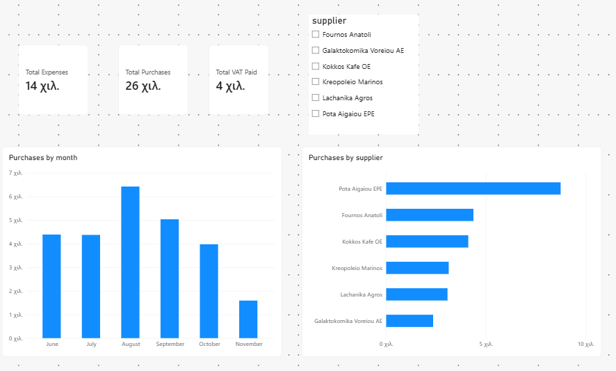
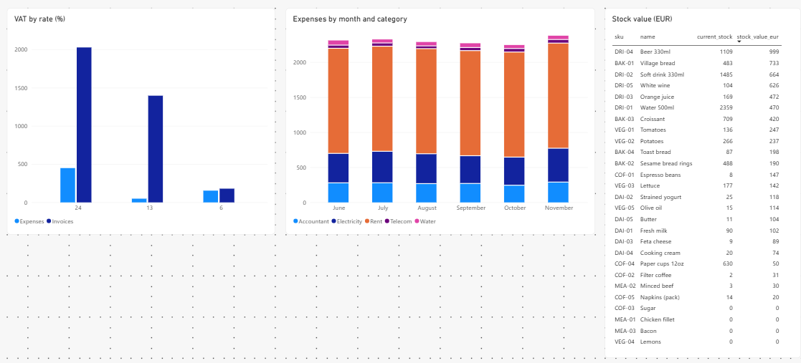

# Invoice, Expense & Stock Manager

A small application for recording purchase invoices, expenses and stock for a
fictional cafe-restaurant. It is a portfolio prototype that runs on synthetic data,
not a production system.

Built with Python, SQLite, Pandas and Streamlit, with a Power BI dashboard on top.



## What it does

- Purchase invoices with lines, VAT per line (24%, 13%, 6%) and calculated totals
- Every invoice line creates an IN stock movement automatically
- Manual stock movements: OUT (usage) and ADJUST (corrections)
- Current stock and products at or below reorder level
- Expenses (rent, utilities, etc.)
- Import and export of invoices as JSON and XML, with validation and an import report
- 5 SQL reports and CSV export for Power BI
- Power BI dashboard with 2 pages and 3 DAX measures

## Project structure

```
app.py              Streamlit UI
db.py               database connection and creation
db/schema.sql       tables, constraints, indexes, stock view
money.py            amounts in cents, VAT rounding
validation.py       business rules
operations.py       create suppliers, products, expenses, invoices
stock.py            stock movements and stock levels
import_export.py    JSON / XML import and export, data mapping
reports.py          SQL reports and Power BI export
seed_data.py        synthetic demo data
samples/            example import files (valid and invalid invoices)
tests/              pytest tests
powerbi/            Power BI dashboard (dashboard.pbix)
docs/               ER diagram, data mapping, Power BI notes, screenshots
```

## Getting started (Windows)

```
python -m venv .venv
.venv\Scripts\activate
pip install -r requirements.txt
python seed_data.py
streamlit run app.py
```

On macOS / Linux, activate with `source .venv/bin/activate`.

Run the tests:

```
pytest
```

## Database

7 tables: `suppliers`, `products`, `vat_rates`, `invoices`, `invoice_lines`,
`expenses`, `stock_movements`, and the view `v_stock_levels`.
See the [ER diagram](docs/er_diagram.md).

Design decisions:

1. `invoices` are purchase invoices only. There is no sales module; stock leaving
   the shop is recorded as OUT movements.
2. Stock is not stored in a column. It is the sum of `stock_movements`, so there is
   one source of truth and a full history.
3. Each invoice line keeps the VAT rate of the day it was bought. Changing a
   product's VAT later does not change old invoices.
4. Amounts are stored as integer cents and rounded half-up with `Decimal`,
   to avoid float rounding errors.
5. Validation happens twice: in Python (clear error messages, all errors at once)
   and in the database (CHECK, UNIQUE and foreign key constraints as a safety net).
6. An invoice is saved in one transaction (header, lines, stock movements):
   either everything is saved or nothing is.

## Import / export

See [data mapping](docs/data_mapping.md) for how file fields map to database columns.
Try it with the files in `samples/`: each has one valid and one invalid invoice.

## Reports

- Purchases by month
- Purchases by supplier (with share %)
- VAT by rate, for invoices and expenses
- Expenses by category and month
- Stock value at average purchase cost

## Power BI dashboard

`powerbi/dashboard.pbix` uses the exported CSV files. Two pages:

1. Purchases: total purchases, VAT paid and expenses, purchases by month and
   by supplier, with a supplier slicer.
2. VAT & Stock: VAT by rate for invoices and expenses, expenses by month and
   category, stock value per product.




See [Power BI notes](docs/powerbi.md) for the data, the DAX measures and how the
decimal separator issue with Greek regional settings was fixed.

## Tests

43 test functions (69 test cases with parameters) covering money rounding,
validation rules, invoice creation, stock movements, JSON/XML import and export
(including a round trip), database constraints, seed data consistency and reports.

## Limitations

- Synthetic data only. Supplier names and VAT numbers are made up, and the VAT
  category of each product is illustrative, not an official tax classification.
- Single user, no authentication.
- XML is parsed with the standard library. For files from untrusted sources,
  `defusedxml` would be the safer choice.
- The stock check for an OUT movement uses the current total, not the stock
  on the movement's date.
