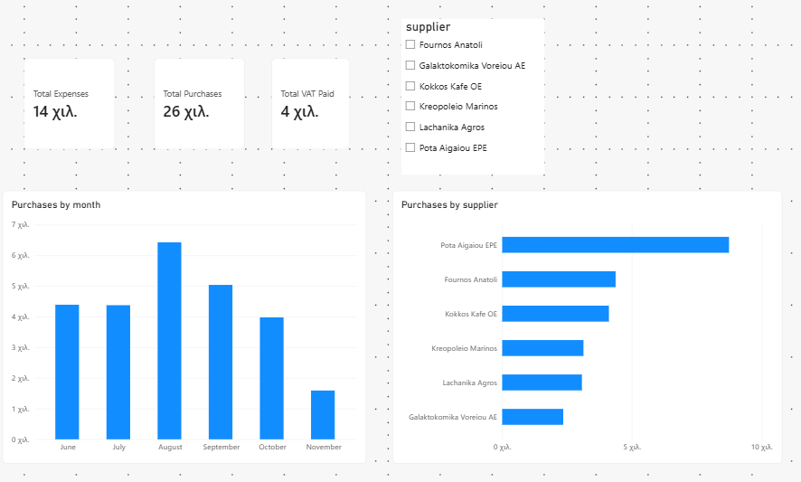
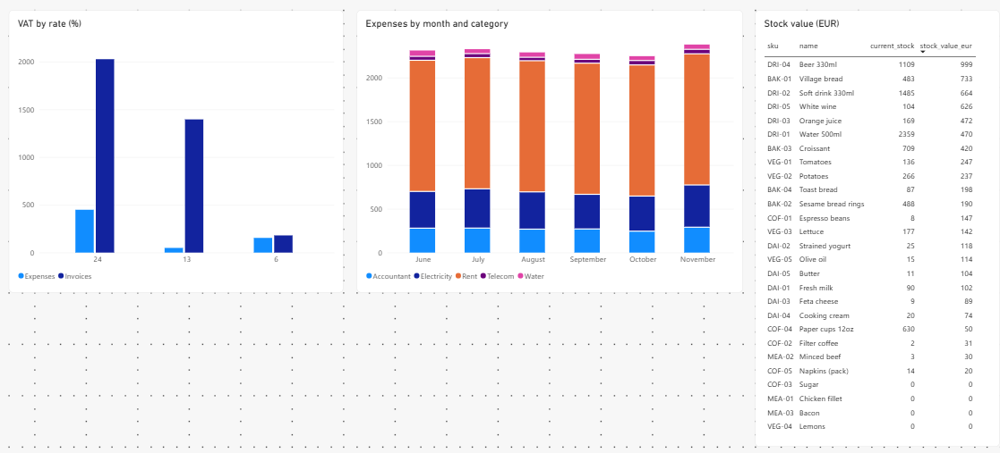

# Power BI dashboard

File: `powerbi/dashboard.pbix`, built in Power BI Desktop from CSV files
exported by the application.

## Data

In the app: Reports page, button "Export CSV files for Power BI".
Or from the terminal:

```
python -c "from db import get_connection; from reports import export_for_powerbi; export_for_powerbi(get_connection(), 'exports')"
```

This writes 7 files to `exports/`. The dashboard uses four of them:

- `purchase_lines.csv`: one row per invoice line (date, supplier, product, amounts)
- `expenses.csv`: one row per expense
- `vat_by_rate.csv`: VAT per rate, for invoices and expenses
- `stock_value.csv`: current stock and its value at average purchase cost

The other three (`purchases_by_month`, `purchases_by_supplier`, `expenses_by_category`)
are summaries that Power BI can calculate from `purchase_lines` and `expenses`.

### Decimal separator

The CSV files use a dot as decimal separator (`14.13`). On a computer with Greek
regional settings, Power BI read `14.13` as `1413`. The fix was to give the type
conversion step in Power Query an explicit culture:

```
= Table.TransformColumnTypes(#"Promoted Headers", { ... }, "en-US")
```

The totals were then checked against the database: purchases 25,792.24 EUR,
purchase VAT 3,603.46 EUR, expenses 13,821.01 EUR.

## Measures (DAX)

```
Total Purchases = SUM(purchase_lines[gross_eur])
Total VAT Paid  = SUM(purchase_lines[vat_eur])
Total Expenses  = SUM(expenses[net_eur])
```

## Pages

1. Purchases: cards for the three measures, purchases by month, purchases by
   supplier, and a supplier slicer that filters the page.
2. VAT & Stock: VAT by rate (invoices vs expenses), expenses by month and
   category, and a table of stock value per product.



